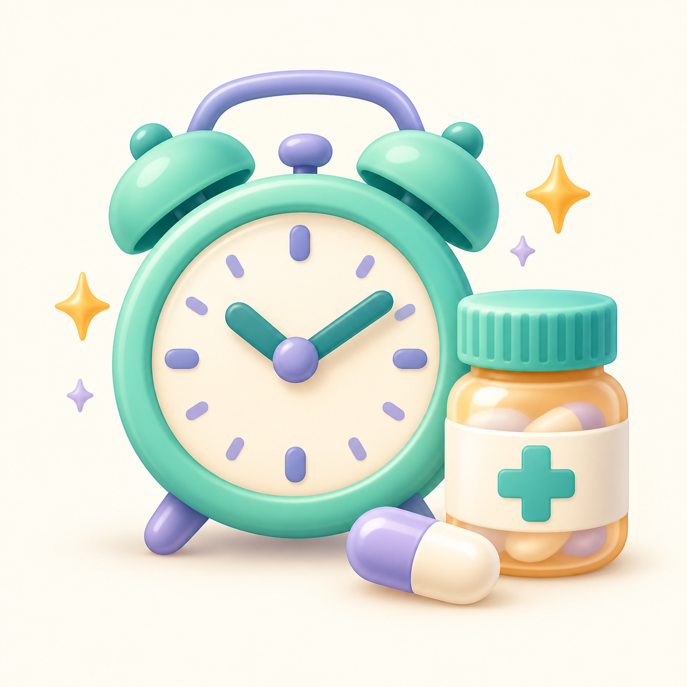
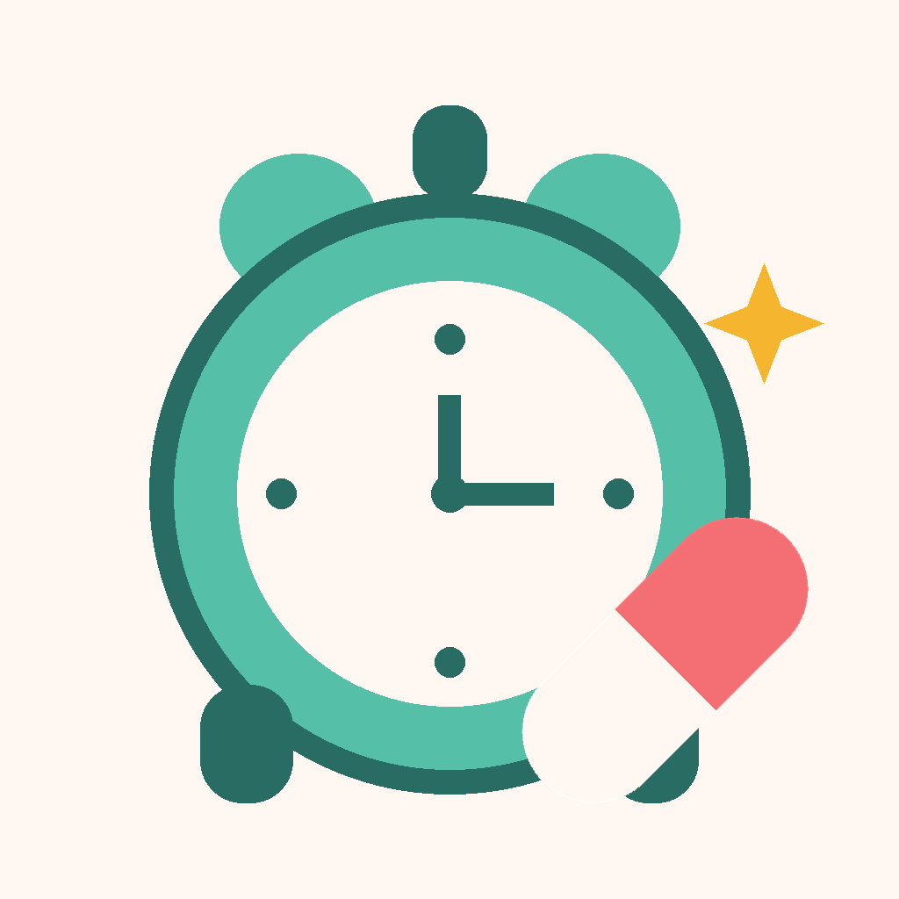

<div align="center">
  
  <h1>Dosey</h1>
  <p><strong>A local medicine reminder and dose log built with Flutter.</strong></p>
  <p>
    
    
    
    
  </p>
  <p><a href="https://github.com/Maher-Tec/Dosey">GitHub repository</a></p>
</div>

> **Reminder only, not medical advice. Always follow the label and your doctor.**

Dosey lets a caregiver keep a local list of medicines, log doses, and see the next due time for each medicine. It schedules local notifications on supported mobile platforms. It does not calculate or validate a medical treatment plan.

## At a glance

| | What Dosey does |
|---|---|
| 💊 **Medicine list** | Add, edit, and remove user-entered medicine details. |
| ⏱️ **Independent timers** | Each medicine gets its own next-dose time based on its last logged dose and interval. |
| 🧾 **Dose history** | Review recorded doses with medicine-name and dose-label snapshots. |
| 🔔 **Local reminders** | Schedule the next reminder on the device, subject to platform permissions and power settings. |
| 🌷 **French + Derja** | French interface with an optional Tunisian Derja tone for reminder notifications. |
| 🧸 **Animated mascot** | Original looping Lottie JSON: Doudou gives a gentle bounce, blink, and sparkle. It pauses when reduced motion is enabled. |
| 🔒 **Local-first data** | Store app data locally; no account, sync, or app backend. Data is unencrypted. |

<div align="center">
  
  <br />
  <sub>Launcher icon · bundled with Android, iOS, web, and Windows builds</sub>
</div>

## Screens and everyday flow

| Screen | Purpose |
|---|---|
| **Home** | Shows each medicine as its own card, with its dose label, interval, next due time/countdown, and actions. |
| **History** | Lists recorded dose events newest first. Each entry keeps a snapshot of medicine details from the time it was logged. |
| **Settings** | Edit the child profile label, toggle Derja reminder wording, enable notifications, and read the safety and privacy notes. |

### 1. Add a medicine

Use **Ajouter** on Home to enter a name, free-text dose label, interval from 1 to 24 hours, emoji, and color. The form can also mark a dose as already given. If selected, Dosey records that time as the last dose and creates the first history entry. Otherwise, a next-dose timer starts after the first dose is logged.

### 2. Log a dose

Choose the medicine and mark its dose as given. Dosey records the current time, adds a history item, saves the updated medicine and history, and schedules that medicine's next reminder. A time in the future or a dose earlier than the calculated due time is rejected.

### 3. Calculate each next dose

For a medicine with a logged dose:

```text
nextDoseAt = lastGivenAt + intervalHours
```

The interval starts from the time the dose is logged. Logging late moves that medicine's next due time forward. Every medicine has its own timer and notification identifier; a new dose replaces that medicine's previous upcoming notification.

### 4. Edit or delete

Editing updates the medicine and reconciles its scheduled reminder. Deleting requires confirmation, removes its associated dose history, and attempts to cancel its notification.

## Reminder behavior

Dosey uses `flutter_local_notifications`, `timezone`, and `flutter_timezone` to schedule local notifications. Notification delivery is controlled by the device operating system.

| Platform behavior | Implementation | Practical limit |
|---|---|---|
| Android alarm precision | Uses `exactAllowWhileIdle` when Android reports exact-alarm access; otherwise uses `inexactAllowWhileIdle`. | Inexact alarms can arrive late. Battery restrictions and manufacturer policies can delay or suppress reminders. |
| Permission | Notification permission is requested from Settings. | If permission is denied or later disabled, notifications cannot be shown. |
| App restart | On startup, Dosey loads saved medicines, cancels their old notification IDs, then schedules future reminders again. | Startup restoration happens when the app is opened. |
| Reboot | Android manifest includes the notification plugin's boot and package-replacement receivers. | Reboot delivery has not been exhaustively verified on every device. |
| Clock/timezone change | The app refreshes the local timezone and reconciles schedules when it receives a system time/timezone event and when the app resumes. | Device-specific behavior can still affect delivery. |
| iOS | Local notifications are configured through the same plugin with timezone-aware dates. | Physical iPhone reminder delivery has not been verified. |

A reminder is a convenience only. Do not depend on the app as the sole way to follow a medication schedule.

## Safety

> **Reminder only, not medical advice. Always follow the label and your doctor.**

Dosey records user-entered medicine names, dose labels, and intervals. It does not verify medication instructions, recommend a dose, check interactions, or determine whether a dose is safe to take. Its early-dose guard is a logging rule based on the saved interval, not a clinical check.

## Privacy and storage

| Data | Where it is stored | Notes |
|---|---|---|
| Medicines and dose history | SharedPreferences, serialized as JSON strings (`medicines_v1`, `doses_v1`) | Stored **unencrypted** on the device. |
| Derja toggle and profile label | SharedPreferences (`derja_enabled`, `child_name`) | The default profile label is the neutral text `votre enfant`; it can be edited. |
| Scheduled notification | Local operating-system notification service | Notification text may include the medicine name and dose label. |

The app contains no account, cloud backend, analytics, or synchronization code, and does not send medicine records to a server. Android app-data backup is disabled in the manifest. iOS backup behavior follows the operating system and device settings. Uninstalling normally removes app-local data, subject to platform backup behavior.

**Do not use Dosey to store information that requires encrypted or regulated medical-record storage.**

## Language and tone

Most interface copy is in French. The optional Derja setting changes the reminder notification title and body to playful Tunisian Arabic transliteration. Some playful “Doudou” copy also appears in the interface. The child profile label is editable and has no personal name prefilled.

## State management and structure

Dosey uses Flutter's built-in `ChangeNotifier` pattern; it does not use Provider, Riverpod, BLoC, or Redux.

| Layer | Responsibility |
|---|---|
| `DoseReminderController` | Owns in-memory medicines, dose history, preferences, loading/error state, and app actions. |
| `ListenableBuilder` | Rebuilds subscribed screens when the controller calls `notifyListeners()`. |
| `MedicineStorage` / `MedicineNotifications` | Interfaces that keep persistence and notification operations separate from UI and controller logic. |
| `Medicine` / `Dose` | Domain models with JSON conversion; dose entries snapshot display details for history. |
| `LocalStorageService` | Persists local JSON strings and preferences using SharedPreferences. |
| `NotificationService` | Initializes timezone data, checks permissions, and schedules/cancels notifications. |

Persistence failures roll back most in-memory changes. A notification failure is reported separately because a dose can be saved even when reminder scheduling fails.

<details>
<summary><strong>Browse the main source tree</strong></summary>

```text
lib/
├── app.dart
├── main.dart
├── core/theme/app_theme.dart
└── features/medicines/
    ├── application/dose_reminder_controller.dart
    ├── data/
    │   ├── local_storage_service.dart
    │   ├── notification_messages.dart
    │   └── notification_service.dart
    ├── domain/{dose.dart, medicine.dart}
    └── presentation/
        ├── screens/{app_shell, home_screen, history_screen, settings_screen}.dart
        └── widgets/...

test/
├── controller_logic_test.dart
├── medicine_serialization_test.dart
├── notification_messages_test.dart
└── widget_test.dart
```

</details>

## Packages

| Package | Role |
|---|---|
| [`shared_preferences`](https://pub.dev/packages/shared_preferences) | On-device preferences and JSON-string storage. |
| [`flutter_local_notifications`](https://pub.dev/packages/flutter_local_notifications) | Local notification permissions and scheduling. |
| [`timezone`](https://pub.dev/packages/timezone) | Timezone-aware scheduled dates. |
| [`flutter_timezone`](https://pub.dev/packages/flutter_timezone) | Reads the device's timezone. |
| [`lottie`](https://pub.dev/packages/lottie) | Renders the bundled vector mascot animation from JSON. |
| `cupertino_icons` | Cupertino icon set. |
| `flutter_test` | Unit and widget tests. |
| `flutter_lints` | Dart/Flutter lint rules. |
| `flutter_launcher_icons` | Generates platform launcher icons from `assets/icon.png`. |

The Dart SDK constraint is `^3.10.8`; see `pubspec.yaml` for dependency versions.

## Run locally

```bash
flutter pub get
flutter run
```

Run checks:

```bash
flutter analyze
flutter test
```

Build an Android debug APK:

```bash
flutter build apk --debug
```

There is no seeded sample-medication mode in the app. New installs open with an empty medicine list; enter your own example data locally if you need to explore the screens.

The animation is authored in `assets/animations/doudou_bounce.json`; it is bundled locally and makes no network request.

## Known limitations

- Notifications are best-effort and can be late or suppressed by permissions, exact-alarm access, battery policies, Do Not Disturb, or device behavior.
- Only the next reminder for each medicine is scheduled; another is calculated after a dose is recorded.
- SharedPreferences is suitable for this small local dataset; large histories would need a database and migration approach.
- No cloud sync, multi-device sharing, medicine interaction checks, dose calculator, or adherence export is implemented.
- Reminder behavior has been exercised in a demo on a Samsung Galaxy S22, but reboot/timezone reliability and exact-alarm availability were not exhaustively verified. iOS has not been tested on a physical iPhone.
- Review application identifiers and store metadata before a production release; Android currently uses the example-style identifier `com.example.dosereminder`.

## License

MIT © 2026 Maher Ahmed. See [`LICENSE`](LICENSE).
